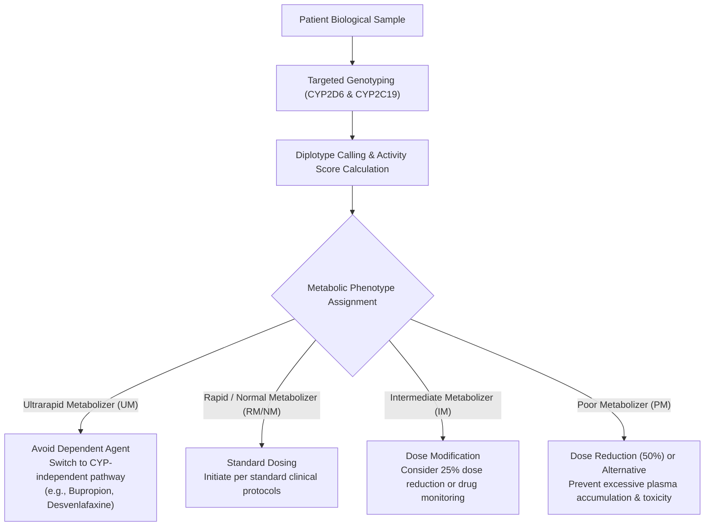

# CYP2D6 and CYP2C19 Polymorphisms as Predictors of Antidepressant Response

**Precision Psychiatric Pharmacogenomics for Major Depressive Disorder (MDD)**

This repository hosts the source manuscript, literature synthesis data, and publication-ready rendered PDF for a scientific review examining the clinical utility of pharmacogenomics (PGx) in Major Depressive Disorder. The manuscript is prepared for the Genetics course (BT313IU) at the School of Biotechnology, International University – Vietnam National University, Ho Chi Minh City (VNU-HCM), typeset in the Elsevier five-column layout (5p) using Quarto.

---

## Direct Document Access for Wet-Lab Scientists

Researchers, clinicians, and reviewers who only wish to read or download the complete review **do not need to install any programming tools or run any software**:

- **Full Review Article (PDF):** Open or download [`pgx-antidepressant-response_article.pdf`](./pgx-antidepressant-response_article.pdf) directly from the repository.
- **Assignment Cover Page (PDF):** Open or download [`assignment_cover-page.pdf`](./assignment_cover-page.pdf).
- **Automated Releases (PDF Packages):** Download from [GitHub Releases](https://github.com/ht2905/pgx-antidepressant-response-paper/releases/latest) without cloning the repository.
- **CI/CD Workflow Artifacts:** View build summaries and download fresh outputs from [GitHub Actions](https://github.com/ht2905/pgx-antidepressant-response-paper/actions/workflows/build-manuscript.yml).

---

## Executive Scientific Summary

Major Depressive Disorder affects over 280 million individuals globally. Despite the availability of numerous pharmacological options, initial antidepressant prescribing remains largely empirical (trial-and-error). In the landmark STAR*D trial, approximately 30% of patients failed to achieve symptom remission across successive therapeutic trials, leading to Treatment-Resistant Depression (TRD), prolonged morbidity, and increased incidence of adverse drug reactions (ADRs).

This review synthesizes clinical, pharmacokinetic, and mechanistic evidence demonstrating that genetic polymorphisms in Phase I hepatic cytochrome P450 enzymes—primarily ***CYP2D6*** and ***CYP2C19***—directly govern the metabolic clearance and steady-state serum concentrations of Selective Serotonin Reuptake Inhibitors (SSRIs) and Tricyclic Antidepressants (TCAs).

### Clinical Pharmacogenomics Workflow



### High-Yield Phenotype & Dosing Reference Table

The following table summarizes evidence-based guidelines from the Clinical Pharmacogenetics Implementation Consortium (CPIC) and the Dutch Pharmacogenetics Working Group (DPWG):

| Gene | Metabolic Phenotype | Activity Score (AS) / Genotype | Key Substrates Affected | Primary Clinical Recommendation |
|---|---|---|---|---|
| *CYP2D6* | Ultrarapid Metabolizer (UM) | AS > 2.0 (gene duplication) | Amitriptyline, Nortriptyline, Paroxetine, Venlafaxine | Avoid *CYP2D6*-dependent agents; switch to an alternative not metabolized by *CYP2D6* (e.g., bupropion, vilazodone, desvenlafaxine). Escalating dose is ineffective. |
| *CYP2D6* | Normal Metabolizer (NM) | AS = 1.25 to 2.0 | All standard substrates | Initiate therapy with recommended standard dosing. |
| *CYP2D6* | Intermediate Metabolizer (IM) | AS = 0.25 to 1.0 | Amitriptyline, Nortriptyline | Consider a 25% lower starting dose; monitor plasma levels and therapeutic response. |
| *CYP2D6* | Poor Metabolizer (PM) | AS = 0 (two null alleles) | Amitriptyline, Fluoxetine, Paroxetine | Reduce starting dose by 50% or choose an alternative drug to prevent acute intoxication and severe anticholinergic/sedative toxicity. |
| *CYP2C19* | Ultrarapid Metabolizer (UM) | *17/*17 (increased expression) | Escitalopram, Citalopram, Sertraline | High risk of subtherapeutic drug exposure and clinical failure. Avoid escitalopram/citalopram or choose non-CYP2C19 alternatives. |
| *CYP2C19* | Rapid Metabolizer (RM) | *1/*17 | Escitalopram, Citalopram | Initiate at standard dose; if nonresponse occurs, switch to an alternative agent. |
| *CYP2C19* | Normal Metabolizer (NM) | *1/*1 (reference activity) | Escitalopram, Citalopram, Sertraline | Initiate therapy at standard recommended dose. |
| *CYP2C19* | Intermediate Metabolizer (IM) | *1/*null or *17/*null | Escitalopram, Citalopram | Standard initial dose; titrate with clinical monitoring. |
| *CYP2C19* | Poor Metabolizer (PM) | Two loss-of-function alleles (*2, *3) | Escitalopram, Citalopram, Sertraline | Reduce starting dose by 50% or choose alternative antidepressant to avoid cardiotoxicity (including dose-dependent QT interval prolongation). |

### Pharmacokinetic Failure vs. True Treatment Resistance

A central insight of psychiatric PGx is distinguishing **pharmacokinetic failure** (subtherapeutic serum exposure caused by rapid clearance in UMs, or severe ADR-induced nonadherence in PMs) from **pharmacodynamic resistance** (failure to respond despite verified therapeutic target engagement). PGx testing unmasks pseudo-resistance, enabling clinicians to make rational, targeted medication adjustments before labeling a patient with TRD.

---

## Repository Structure

All repository paths and filenames adhere to the lowercase faceted naming standard (`{scope}_{doc-type}.{ext}`):

| Path / File | Semantic Facet | Description |
|---|---|---|
| [`pgx-antidepressant-response_article.pdf`](./pgx-antidepressant-response_article.pdf) | Publication Deliverable | Precompiled, publication-quality review article in Elsevier 5p layout. |
| [`pgx-antidepressant-response_article.qmd`](./pgx-antidepressant-response_article.qmd) | Manuscript Source | Core Quarto manuscript text, citations, metadata, and Elsevier configuration. |
| [`assignment_cover-page.pdf`](./assignment_cover-page.pdf) | Coursework Deliverable | Formal academic course submission cover sheet. |
| [`figures/cyp2d6_duplication-distribution.png`](./figures/cyp2d6_duplication-distribution.png) | Asset / Media | Global interethnic distribution map of *CYP2D6* duplication frequencies. |
| [`manuscript_preamble.tex`](./manuscript_preamble.tex) | Configuration / TeX | LaTeX header managing hyperlinks, line wrapping, and table float layouts. |
| [`bibliography.bib`](./bibliography.bib) | Reference / BibTeX | Comprehensive bibliography of cited clinical trials, CPIC/DPWG guidelines, and PGx reviews. |
| [`_quarto.yml`](./_quarto.yml) | Project Config | Quarto workspace and rendering configuration. |
| [`_extensions/`](./_extensions/) | Template Dependencies | Bundled Elsevier Quarto journal extension (`quarto-journals/elsevier`) for offline reproducibility. |
| [`.github/workflows/build-manuscript.yml`](./.github/workflows/build-manuscript.yml) | CI/CD Pipeline | Automated GitHub Actions workflow compiling the PDF and archiving build artifacts. |
| [`pgx-antidepressant-response_article.Rproj`](./pgx-antidepressant-response_article.Rproj) | Workspace Config | RStudio project descriptor for integrated GUI editing. |
| [`renv.lock`](./renv.lock) & [`renv/`](./renv/) | Package Environment | Reproducible R package management state. |

---

## How to Build the Manuscript Locally

The Quarto manuscript is completely self-contained. The Elsevier journal format files are pre-bundled in the repository under `_extensions/`, eliminating external network dependencies during rendering.

### Prerequisites

You only need:
1. **Quarto CLI (version 1.3 or later):** [quarto.org/docs/get-started](https://quarto.org/docs/get-started/)
2. **TinyTeX or standard LaTeX distribution:**
   ```bash
   quarto install tinytex
   ```

### Command-Line Compilation (Recommended)

From the project root directory, run:

```bash
quarto render pgx-antidepressant-response_article.qmd
```

Quarto automatically compiles the LaTeX source via LuaLaTeX, incorporates all BibTeX citations, attaches figures, and generates `pgx-antidepressant-response_article.pdf`.

### RStudio Desktop GUI Workflow

1. Double-click [`pgx-antidepressant-response_article.Rproj`](./pgx-antidepressant-response_article.Rproj) to open the project in RStudio.
2. In the Files tab, open [`pgx-antidepressant-response_article.qmd`](./pgx-antidepressant-response_article.qmd).
3. Click the **Render** button in the editor toolbar (or press `Ctrl+Shift+K` on Windows/Linux, `Cmd+Shift+K` on macOS).
4. The generated PDF opens immediately in the preview pane.

---

## Continuous Integration & Linux Dependency Architecture

This repository includes an automated CI/CD pipeline ([`.github/workflows/build-manuscript.yml`](./.github/workflows/build-manuscript.yml)) that runs on every commit and pull request.

### Bundled Linux System Dependencies

Scientific LaTeX and Quarto rendering on Ubuntu/Linux requires specific system libraries for font shaping, image rasterization, and document generation. The CI/CD pipeline guarantees zero-failure compilation by bundling:

- **Graphics and Font Rendering Libraries:** `fontconfig`, `libfontconfig1-dev`, `libfreetype6-dev`, `libharfbuzz-dev`, `libfribidi-dev`
- **Image Compression Libraries:** `libpng-dev`, `libtiff-dev`, `libjpeg-dev`
- **Network and Parsing Utilities:** `libcurl4-openssl-dev`, `libssl-dev`, `libxml2-dev`
- **Document Processors:** `ghostscript`, `perl`, `build-essential`
- **TeX Live Packages:** `elsarticle`, `natbib`, `threeparttable`, `placeins`, `breakurl`, `float`, `array`, `hyperref`, `url`, `amsmath`, `amsfonts`

### Automated Artifact Delivery

Every successful workflow execution generates:
1. `pgx-antidepressant-response-manuscript`: The compiled manuscript PDF, downloadable from the GitHub Actions run summary.
2. `assignment-cover-page`: The official coursework cover sheet.
3. On pushes to `main`, an automated GitHub Release (`latest`) is updated with the production deliverables attached.

---

## Academic Context & Author Team

- **Course:** Genetics (BT313IU)
- **Institution:** School of Biotechnology, International University – Vietnam National University, Ho Chi Minh City (VNU-HCM)
- **Instructor:** MSc. Hang T. Tong
- **Corresponding Author:** Tran Quoc Hoang ([tranquochoang@protonmail.com](mailto:tranquochoang@protonmail.com))

### Author Contributions (CRediT Taxonomy)

- **Tran Quoc Hoang:** Conceptualization, Methodology, Project Administration, Software (Quarto and LaTeX typesetting), Investigation, Writing – Original Draft (*Section 3.2: Application in Therapy*), Writing – Review & Editing.
- **Nguyen Hoang Thanh Ngan:** Investigation, Writing – Original Draft (*Section 3.1: Genetics in Etiology and Diagnosis*), Writing – Review & Editing.
- **Pham Gia Han:** Investigation, Methodology, Writing – Original Draft (*Section 1: Introduction* and *Section 2: Materials & Methods*), Writing – Review & Editing.
- **Pham Ngo Phuong Thao:** Investigation, Writing – Original Draft (*Section 3.3: Clinical Challenges and Future Directions*), Writing – Review & Editing.
- **Nguyen Hoang Tuong Vy:** Data Curation, Visualization, Writing – Review & Editing.
- **Nguyen Le Ngoc Vy:** Data Curation, Visualization, Writing – Review & Editing.

### Conflict of Interest

The authors declare that they have no known competing financial interests or personal relationships that could have appeared to influence the work reported in this paper.

---

## Citation

```bibtex
@article{tran2025cyp2d6pgx,
  title   = {CYP2D6 and CYP2C19 Polymorphisms as Predictors of Antidepressant Response},
  author  = {Tran, Quoc Hoang and Nguyen, Hoang Thanh Ngan and Pham, Gia Han and Pham, Ngo Phuong Thao and Nguyen, Hoang Tuong Vy and Nguyen, Le Ngoc Vy},
  journal = {Genetics Review (BT313IU), International University - VNU-HCM},
  year    = {2025},
  url     = {https://github.com/ht2905/pgx-antidepressant-response-paper}
}
```
